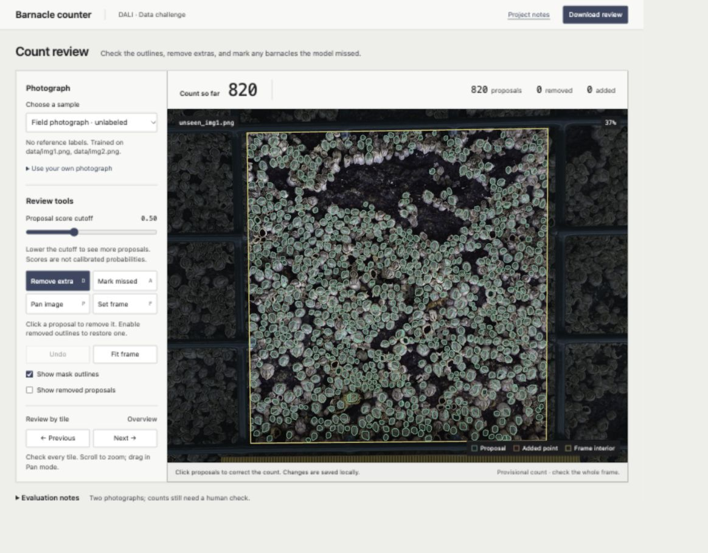
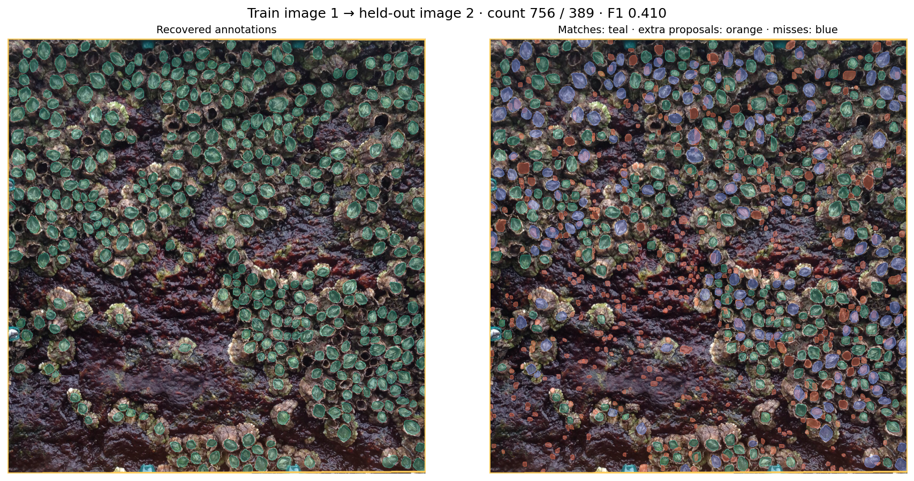

# Barnacle counter

A prototype for the DALI 26F Data Challenge. Mask R-CNN proposes barnacles inside
a selected field frame, and a browser tool lets a scientist remove extras, mark
misses, and download the corrected count with its edit history.

The model makes substantial errors on the two evaluation photographs. The useful
part of this prototype is the combination of inspectable proposals and a way to
correct them. Whether it actually saves counting time needs a separate study.



## Try the review tool

The examples include saved model predictions, so you can try the interface
without installing PyTorch or downloading a checkpoint:

```bash
git clone https://github.com/emiliodaza/barnacle-mask-rcnn.git
cd barnacle-mask-rcnn
python3 -m http.server 8000 --bind 127.0.0.1
```

Open [the local demo](http://127.0.0.1:8000/demo/). Check the gold frame, use the
teal outlines to inspect proposals, remove extras, and mark missed barnacles.
Use **Next** to review the photograph tile by tile. **Download review** saves the
count and corrections as JSON; the sidebar also exports points as CSV. Changes
are saved in this browser, but download anything you want to keep.

The default photograph has **820 model proposals**, not 820 verified barnacles.
Inference runs in Python; the browser only displays and edits its output.
[Review instructions](docs/review_workflow.md) cover shortcuts and new photographs.

## The idea and its boundaries

Counting thousands of barnacles by hand is slow. A model does not have to get
every instance right to provide a starting point, but the scientist must be able
to see and correct its mistakes. Instance segmentation gives each proposal an
outline, which is more useful for this workflow than an unexplained total.

This experiment has three parts:

| Part | Input | Output |
| --- | --- | --- |
| Recover training labels | Supplied blue contour masks | Individual filled masks, checked in overlay figures |
| Propose barnacles | RGB photograph and selected frame corners | Instance masks, centers, scores, and a proposal count |
| Review a count | Photograph and saved proposals | Accepted points, manual additions, and an edit record |

Only two photographs are annotated. A pretrained COCO backbone is a reasonable
starting point, so the prototype trains new Mask R-CNN heads while freezing the
backbone. Two simple baselines provide a comparison: bright connected components
and a count estimated from the other photograph's barnacle density.

The scientist selects the four **inner frame corners**. This avoids relying on
annotation masks that would not exist for a new field photograph. An instance
counts when its filled-mask centroid is inside or on the selected polygon. That
boundary rule is an assumption to confirm with the scientists.

Training and inference use overlapping 512-pixel tiles. Edge-anchored tiles cover
the last strips of the image, and mask overlap removes likely duplicates. Each
mask is stored only in its own bounding box, keeping dense photographs manageable.

## Results

Train on image 1 and evaluate image 2, then reverse the split. Photographs are
separated **before** making patches, so overlapping patches cannot leak across
the split. Each fold starts independently from COCO weights, uses raw RGB, seed
42, and five epochs. Earlier checkpoints trained on both photographs are not used
for these results.

At a score cutoff of 0.5, predicted masks are matched one-to-one to the recovered
annotations at mask IoU ≥ 0.5:

| Train → evaluation | Reference | Proposed | Absolute count error | Precision | Recall | F1 |
| --- | ---: | ---: | ---: | ---: | ---: | ---: |
| Image 1 → image 2 | 389 | 756 | 367 | 31.1% | 60.4% | 0.410 |
| Image 2 → image 1 | 1,702 | 1,027 | 675 | 84.6% | 51.1% | 0.637 |

The supplied annotations are incomplete. These numbers measure agreement with
recovered labels, not independently verified biological counts.



Teal marks matched instances, orange extra proposals, and blue missed references.
The model trained on the dense photograph overcounts the darker photograph. The
reverse fold has better precision but misses many instances in the dense scene.
Incomplete labels and mask-shape differences also affect these results.

The bright-component baseline has count errors of 155 and 720, with F1 scores of
0.003 and 0.000. On image 2 it gets closer to the reference total than Mask R-CNN
while barely matching the individual annotations: misses and extras can cancel.
The density baseline has count errors of 1,805 and 1,400. Neither baseline is
intended to represent the best possible classical vision method.

[Full metrics](results/metrics.csv) include scores 0.25 and 0.75 as sensitivity
checks. They were not used to choose the primary cutoff. The
[experiment protocol](docs/protocol.md) records all settings, and
[report.json](results/report.json) contains training history, timings, and hashes.

A separate model trained on both labeled photographs produces the default 820
proposals on `unseen_img1.png`. It has no reference labels, so its accuracy is
unknown. This model is for the demonstration, not the held-out evaluation.

## Run the experiment

Run commands from the repository root. The recorded environment was Python
3.14.6 on macOS ARM64, using CPU and two PyTorch threads. Dependencies are pinned;
other environments may produce slightly different floating-point results.

```bash
python3 -m venv .venv
source .venv/bin/activate
python -m pip install -r requirements.txt
python -m unittest discover -s tests -v
python -m src.experiment --epochs 5
```

This trains both folds and the separate demonstration model, then rebuilds the
metrics, figures, and browser examples. The recorded run took about eight minutes.
The first training run downloads TorchVision's COCO weights. The supplied images
are included in `data/`, unchanged; hashes are in `data/manifest.json`.

To skip training, download the three `.pth` files from the
[model release](https://github.com/emiliodaza/barnacle-mask-rcnn/releases/tag/v1.0.0),
put them in `outputs/`, and run:

```bash
python -m src.experiment --epochs 5 --reuse
```

This checks training-image IDs and epoch counts, reruns inference, and replaces
the result files. It does not just reload the saved metrics. Checkpoint inference
does not download pretrained weights.

For inference on a photograph alone:

```bash
python -m src.predict --image data/unseen_img1.png \
  --checkpoint outputs/final_raw.pth --score-threshold 0.25 \
  --output results/my-proposals.json
```

For your own photograph, select and download its frame in the browser, then add
`--region path/to/frame-region.json`. Load the original photograph and output JSON
in the review tool. The model assumes a similar pixel scale to the training photos.
Expanding the frame in the browser does not generate new model proposals; rerun
inference for the new region.

## Read the experiment

[The executed notebook](barnacle_notebook.ipynb) follows the question, label audit,
prototype, results, failures, and conclusions. Its cells read saved results;
training is an explicit command rather than something triggered by opening it.

```bash
python -m jupyterlab barnacle_notebook.ipynb
```

For a guided path through the implementation, start with
[the code walkthrough](docs/code_walkthrough.md). To check the code locally:

```bash
python -m unittest discover -s tests -v
node tests/test_review.cjs  # Optional; needs Node.js
```

The app itself needs no Node installation or build step.

## What changed during the experiment

Label processing turned out to matter before any model training. A 3×3 closing
operation joined nearby outlines; removing it changed image-1 recovery from 1,500
to 1,718 contours, with 1,702 inside the selected frame. The audit figures make
that conversion visible. The new count is not proof that every recovered label
is correct.

Memory was another constraint. Storing each instance as a full image-sized mask
would take about 13.7 GB for image 1. Tight boxes reduce the masks to about 0.9 MB,
then the dataset expands only the tile currently needed for training.

The evaluation also changed how to interpret the model. Falling training loss
showed optimization, not counting accuracy. The baseline showed why count error
alone is insufficient. Together, these findings favor a correction workflow over
an automatic counter.

The next experiment should use more independently annotated photographs across
lighting, density, and camera scale. First confirm boundary and live/empty-shell
conventions, audit the recovered labels, and reserve validation images for tuning.
Then compare manual-only and assisted review on verified regions, measuring both
final error and task time. Adding a more complicated model is not the first step.

## Repository guide

| Path | Contents |
| --- | --- |
| `barnacle_notebook.ipynb` | Executed experiment narrative and figures |
| `src/` | Labels, regions, compact masks, training, inference, evaluation, and plotting |
| `config/regions.json` | Manually selected inner-frame corners in original pixels |
| `data/` | Supplied photographs, masks, overlays, and hash manifest |
| `results/` | Measurements, run metadata, matches, and figures |
| `demo/` | Browser review tool and saved model examples |
| `tests/` | Regression checks for counting, matching, tile coverage, and review logic |
| `docs/` | Protocol, review instructions, code walkthrough, and development notes |
| `scripts/build_notebook.py` | Rebuild and optionally execute the notebook |
| `outputs/` | Generated checkpoints, ignored by Git; available in the release |

The original notebook and four preprocessing checkpoints remain locally in
`archive/` and `outputs/`. The current report uses the new, separate training runs.
`unseen_img2.png` was also in the supplied archive; its relationship to the other
photos is unspecified, so it is excluded from the evaluation.

Photographs and annotations come from the DALI challenge dataset. The model setup
follows the [TorchVision fine-tuning tutorial](https://docs.pytorch.org/tutorials/intermediate/torchvision_tutorial.html)
and [Mask R-CNN interface](https://docs.pytorch.org/vision/stable/models/generated/torchvision.models.detection.maskrcnn_resnet50_fpn.html).
Matching uses [SciPy's assignment solver](https://docs.scipy.org/doc/scipy/reference/generated/scipy.optimize.linear_sum_assignment.html).
Codex assisted with implementation, refactoring, verification, and documentation;
the measurements were produced by local training and evaluation runs.

DALI also asks for an outside code sample separate from this challenge. The
[submission note](REVIEW.md) lists what is ready and what remains for the application.
