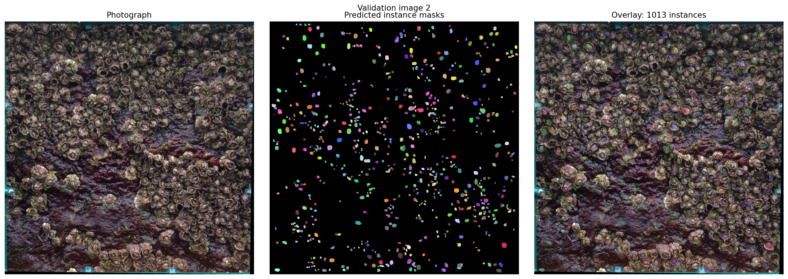
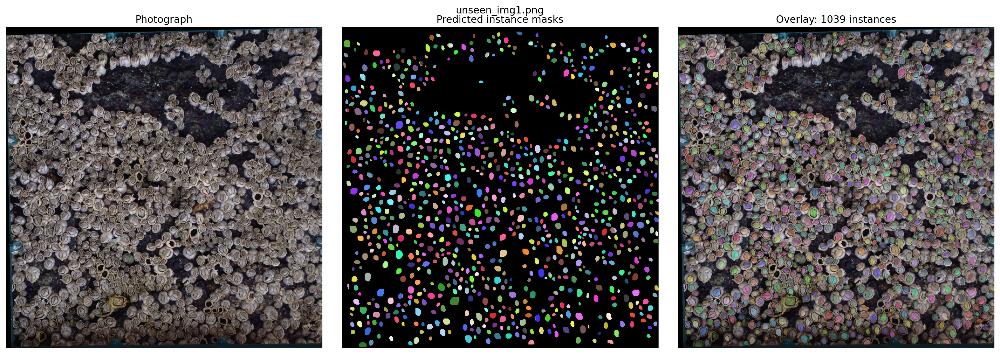
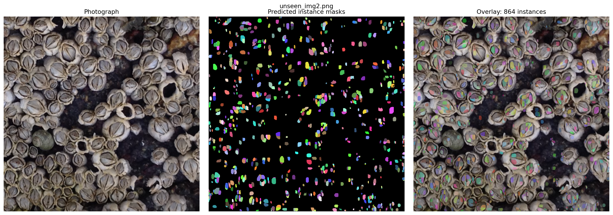

# Barnacle instance segmentation and counting

A prototype for the **DALI Data Challenge 26F**: select a counting region, recover candidate instance masks from the supplied contour annotations, and fine-tune Mask R-CNN to propose barnacle instances in new photographs.

**Start with [the notebook](barnacle_experiment.ipynb).** It contains the investigation, commented code, saved results, and limitations. Its saved figures can be viewed on GitHub without running the GPU experiment.

## Approach

1. Inspect matching photograph and annotation crops, then measure the blue outlines in HSV color space.
2. Recover enclosed regions using connected components and assign each candidate interior an instance ID. These recovered labels are provisional.
3. Select the inside corners of the sampling frame with sliders and save the coordinates in original-image pixels.
4. Train a COCO-pretrained **Torchvision Mask R-CNN with a ResNet-50 backbone and Feature Pyramid Network** on image 1. The experiment uses small-object anchors, horizontal flips, mixed precision, and 200 optimizer updates.
5. Use image 2 to compare nine confidence/mask-threshold combinations. Select by instance F1 at mask IoU 0.5, with count error used to break ties.
6. Apply the selected thresholds to both unseen photographs and save their predicted counts and segmentation overlays.

The model receives clean RGB photographs, not the supplied contour images. Contours are used to build the training and validation references. The additional close-up, `unseen_img2.png`, is an unlabeled qualitative stress test.

## Repository contents

| Path | Purpose |
| --- | --- |
| [`barnacle_experiment.ipynb`](barnacle_experiment.ipynb) | Main notebook: data inspection, annotation recovery, selectors, model experiment, and results. |
| [`Barnacles/`](Barnacles/) | Input photographs, contour annotations, and the cropped overlay used for inspection. |
| [`configs/regions.json`](configs/regions.json) | Saved training/validation corners, image dimensions, and split. |
| [`configs/test_regions.json`](configs/test_regions.json) | Saved corners for both unseen photographs. |
| [`data/processed/instances.npz`](data/processed/instances.npz) | Recovered NumPy instance label maps, stored under `img1` and `img2`. Background is 0; positive values are instance IDs. |
| [`outputs/`](outputs/) | Training loss curve, validation search results, segmentation figures, and JSON summaries from the Discovery run. |
| [`requirements.txt`](requirements.txt) | Python dependencies for the notebook. |

All current experiment code is in the notebook. Saved coordinates and label maps allow the model section to run without repeating the interactive preparation.

## Viewing the results locally

Use **Python 3.10** for the dependency versions in this repository. From the repository root:

```bash
python3.10 -m venv .venv
source .venv/bin/activate
python -m pip install -r requirements.txt
jupyter notebook barnacle_experiment.ipynb
```

To inspect the existing results, run only the self-contained code cell under **Results**. It reads the committed JSON summaries and PNG figures and does not require CUDA. The earlier inspection and corner-selection sections can also run locally. Interactive sliders require a live notebook kernel; they are not interactive in GitHub's static preview.

## Reproducing the model experiment

The saved experiment was run on **Dartmouth Discovery**, using Python 3.10, PyTorch **2.1.2+cu118**, Torchvision **0.16.2+cu118**, and an NVIDIA A100 MIG allocation with approximately 40 GB of GPU memory. Another compatible NVIDIA GPU environment can run the same code; cluster access and allocation procedures depend on the host.

For a fresh Python 3.10 GPU environment, install the recorded CUDA 11.8 PyTorch build **before** the remaining requirements:

```bash
python -m pip install torch==2.1.2 torchvision==0.16.2 --index-url https://download.pytorch.org/whl/cu118
python -m pip install -r requirements.txt
```

See the [official PyTorch installation commands](https://pytorch.org/get-started/previous-versions/#v212) for other supported builds.

From the repository root, run the notebook cells from **Model experiment** through **Predicting both unseen photographs**, in order, in the same CUDA-backed Python kernel. The first model cell checks for CUDA. These cells independently load:

- `Barnacles/img1.png`, `img2.png`, `unseen_img1.png`, and `unseen_img2.png`;
- `configs/regions.json` and `configs/test_regions.json`;
- `data/processed/instances.npz`.

The first model construction downloads the COCO-pretrained weights if they are not already cached. The experiment writes new PNG, CSV, and JSON results to `outputs/`, replacing the corresponding saved files. Run the **Results** cell afterward to display them. Seeds are fixed, but exact predictions may vary across hardware and library builds.

To regenerate the annotations or change a counting region, run the earlier preparation and selection sections first. The selectors start from the committed coordinates. Changing a selection changes the region being counted and requires regenerating the dependent results.

## Recorded results

Validation uses **410 recovered reference instances after resizing**, down from 426 before resizing. Both counts exclude the single-pixel candidates removed by preprocessing. The metrics describe agreement with these provisional labels.

| Setting | Confidence | Mask threshold | Precision | Recall | F1 | Predicted count | Absolute count error |
| --- | ---: | ---: | ---: | ---: | ---: | ---: | ---: |
| Baseline | 0.5 | 0.5 | 0.091 | 0.137 | 0.109 | 614 | 204 |
| Selected by F1 | 0.3 | 0.5 | 0.094 | 0.232 | 0.134 | 1,013 | 603 |

Lowering the confidence threshold improved recall and F1, while count error increased. Selecting the best instance F1 therefore did not select the closest total count. The complete search is in [`validation_tuning.csv`](outputs/validation_tuning.csv).



The unseen-image counts are **1,039** and **864**. Neither is a verified count because reference annotations are unavailable.





## Interpretation, limitations, and learning

The training loss decreased, and many predictions visually align with barnacles in the wider view. The close-up exposes fragmented detections on individual barnacles, suggesting sensitivity to changes in object scale and appearance. Viewpoint was not isolated as the cause.

Validation agreement remains weak. There is only one training photograph and one validation photograph, and the recovered masks may contain missing, merged, or fragmented candidates. Threshold selection uses the same validation image on which the comparison is reported, so it is not an independent test estimate.

The prototype requires human review before its counts can be trusted. The next steps would be to audit the reference masks, test processing resolutions and training-scale variation, and evaluate on additional independently annotated photographs. A practical evaluation would also measure whether reviewing predictions saves time over manual counting.

The main lessons from the experiment are that annotation recovery is part of the modeling problem, lower training loss does not establish generalization, and instance-matching quality and total-count accuracy can favor different settings. Keeping the close-up failure case makes those limitations visible.
